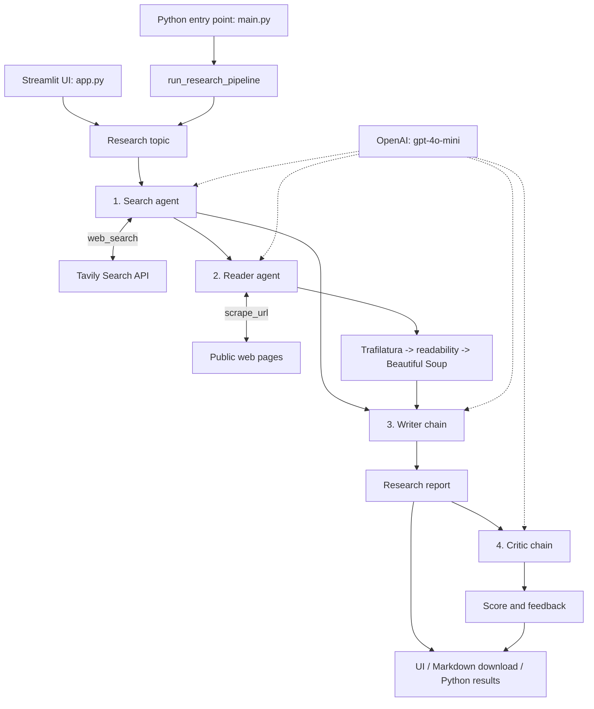

# Multi-Agent Research Assistant

A Python research assistant that searches the web, extracts article content, writes a structured report, and reviews its quality. Built with LangChain, OpenAI, Tavily, and Streamlit.

Use the browser interface to research a topic and download a Markdown report, or run the pipeline from Python.

## Features

- **Web research:** retrieve up to five search results per tool call, including titles, URLs, and snippets.
- **Content extraction:** extract readable page content using multiple fallback strategies.
- **Report generation:** produce an introduction, key findings, conclusion, and source URLs.
- **Quality review:** generate a score out of 10, strengths, areas to improve, and a verdict.
- **Interactive UI:** view pipeline stages, inspect research outputs, and download the final report.
- **Python pipeline:** reuse the research workflow from your own scripts.

## Technology stack

| Technology | Purpose |
| --- | --- |
| Python | Application and pipeline implementation |
| LangChain / LangChain Core | Tool-calling agents, prompt templates, and runnable chains |
| LangChain OpenAI / OpenAI | Access to `gpt-4o-mini`, currently configured with temperature `0` |
| Tavily | Web search API |
| Streamlit | Browser interface, session state, and report downloads |
| Requests | HTTP requests to source pages |
| Trafilatura | Primary article-text extraction |
| readability-lxml / Beautiful Soup / lxml | Fallback extraction and HTML parsing |
| python-dotenv | Load local API credentials from `.env` |
| Rich | Terminal output utilities |

Dependencies are listed in [requirements.txt](requirements.txt).

## Architecture

The workflow runs sequentially: **two tool-calling agents**, followed by **two LLM chains**. It is not a parallel agent swarm.



Both entry points reuse the agents and chains defined in [src/agents/agents.py](src/agents/agents.py). The Streamlit app manages its own orchestration and session state; the script uses [src/pipelines/pipeline.py](src/pipelines/pipeline.py).

The reader is prompted to select the most relevant URL from the first 800 characters of the search output. Extracted page text is normalized and limited to 5,000 characters before being returned by the scraping tool.

## Getting started

### Prerequisites

- **Python 3.11 recommended**.
- Git.
- An [OpenAI API key](https://platform.openai.com/api-keys) with access to `gpt-4o-mini`.
- A [Tavily API key](https://app.tavily.com/).
- Internet access for model calls, search, and page retrieval.

API usage may incur charges and is subject to provider quotas.

### 1. Clone the repository

```powershell
git clone https://github.com/angetanon/LangChain-Multi-Agent-Research-System.git
cd LangChain-Multi-Agent-Research-System
```

### 2. Create and activate a virtual environment

**Windows PowerShell**

```powershell
python -m venv .venv
.\.venv\Scripts\Activate.ps1
```

**macOS / Linux**

```bash
python3 -m venv .venv
source .venv/bin/activate
```

Alternatively, use Conda:

```powershell
conda create -n langagent python=3.11 -y
conda activate langagent
```

Use one environment consistently for installation and execution. If the project already has both `venv` and `.venv`, activate the one where you install the dependencies.

### 3. Install dependencies

```powershell
python -m pip install -r requirements.txt
```

The dependency file uses minimum versions rather than a locked environment. The agent implementation uses `langchain.agents.create_agent`, so it requires a modern LangChain release that provides that API; older `0.2.x` releases do not.

### 4. Configure API keys

Create a `.env` file in the project root:

```dotenv
OPENAI_API_KEY=your_openai_api_key
TAVILY_API_KEY=your_tavily_api_key
```

The application loads these values with `python-dotenv`. Keep credentials private and never commit your `.env` file.

### 5. Start the application

Run from the project root:

```powershell
python -m streamlit run app.py
```

Open the local URL printed in the terminal, normally **http://localhost:8501**.

1. Enter a topic in **Research Topic**.
2. Select **Run Research Pipeline**.
3. Wait for the search, reader, writer, and critic stages.
4. Review the report and feedback, then select **Download Report (.md)** to save it.

## Run from Python

To run the included example:

```powershell
python main.py
```

Change the `topic` value in [main.py](main.py) to research a different subject. The script prints each stage and the final outputs.

You can also call the pipeline directly:

```python
from src.pipelines.pipeline import run_research_pipeline

results = run_research_pipeline("How are AI agents changing software development?")

print(results["report"])
print(results["feedback"])
```

The returned dictionary contains `search_results`, `scraped_content`, `report`, and `feedback`.

To change the model or prompts, edit [src/agents/agents.py](src/agents/agents.py).

## Project structure

```text
LangChain-Multi-Agent-Research-System/
|-- app.py                     # Streamlit interface and UI orchestration
|-- main.py                    # Example terminal entry point
|-- requirements.txt           # Python dependencies
|-- demo.excalidraw             # Excalidraw diagram file
|-- src/
|   |-- agents/
|   |   `-- agents.py          # Search/reader agents and writer/critic chains
|   |-- pipelines/
|   |   `-- pipeline.py        # Sequential Python research pipeline
|   `-- tools/
|       `-- tools.py           # Tavily search and page extraction tools
`-- README.md
```

## Troubleshooting

| Problem | What to check |
| --- | --- |
| `ModuleNotFoundError` (for example, `rich`) | Activate the intended environment and run `python -m pip install -r requirements.txt`. Use that same interpreter to launch the app. |
| Cannot import `create_agent` | Check the installed LangChain version with `python -m pip show langchain`. Use a current release that supports `langchain.agents.create_agent`. |
| Missing or invalid API key | Check the variable names in `.env`, account access, and provider quotas. Restart the app after changing credentials. |
| HTTP 401 / 403 when scraping | The source may require authentication or block automated requests. Choose an accessible source or use an authorized API; the scraper does not bypass access restrictions. |
| Empty or incomplete page text | JavaScript-rendered pages, paywalls, and extraction limits can prevent full retrieval. The scraper fetches HTML with Requests; it does not run a browser. |

For direct calls to LangChain tools, use `.invoke()` with named arguments, for example `scrape_url.invoke({"url": "https://example.com"})`, rather than calling the decorated tool as a regular function.

## Limitations and responsible use

- Reports and critic scores are model-generated, not independent fact-checks. Verify important claims against the original sources.
- Search and scraping coverage is limited; the pipeline does not guarantee exhaustive research.
- Topics, research text, and reports are sent to external services as part of the workflow. Do not submit confidential or sensitive information without appropriate authorization.
- Respect website terms, copyright, access controls, and API rate limits.
- Results are kept in the Streamlit session or returned to the Python caller; there is no database-backed research history.

## Contributing

Issues and pull requests are welcome. For larger changes, open an issue first to discuss the approach.

1. Fork the repository and create a feature branch.
2. Keep changes focused and document any setup or behavior changes.
3. Check the affected workflow locally and describe how you verified it in your pull request.
4. Never include API keys, credentials, or private research data.

## License

No license file is currently included. Public availability alone does not grant an open-source license; contact the maintainer about reuse and redistribution.
